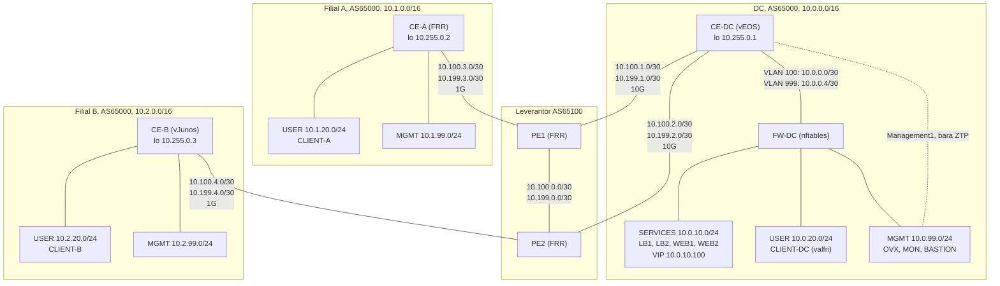

<p align="center">
  
</p>

# Grupparbete - Routing && Switching Avancerad

Grupp 4: automatiserad multi-site-miljö. Grupparbete 1 i kursen Routing och Switching Avancerad,
Nätverkssäkerhet.

Repot är både gruppens arbetsplats och dokumentationen av nätet: ett datacenter (DC) och två
filialer som förbinds via en nätleverantör. Den här filen beskriver hur man kommer igång, vad
lösningen ska uppfylla och hur arbetet är planerat vecka för vecka. Design, val och motiveringar
står i `docs/`.

## Scenario

Företaget har tre platser, DC och filialerna A och B, och använder AS65000 på alla tre.
Platserna förbinds av leverantören AS65100, vars två PE-routrar gruppen själv bygger efter en
fast specifikation. Lösningen ska

- använda eBGP mellan företagets kundroutrar (CE) och leverantörens routrar (PE) på alla platser,
- hålla isär användartrafik och hanteringstrafik över hela nätet med VRF-lite,
- leverera tjänster i DC: en lastbalanserad webbtjänst, en SSH-bastion och en övervakningsserver,
- provisionera servrar, klienter och routrar med OpenVox från en central server i DC,
- vara mätbar och felsökbar med SNMPv3, syslog och sFlow,
- byggas och dokumenteras med ett Git-baserat arbetssätt på GitHub, där repot är dokumentationen.

Hela topologin finns i ett GNS3-projekt och redovisas live, del för del, i vecka 7.
Presentationen är en av kursens två examinationer och bedöms med IG eller G mot kursmål 1–8.
Varje medlem ska kunna förklara den del hen själv har byggt.

## Topologi



Varje WAN-länk bär två VLAN: **VLAN 100** för USER-trafiken i den globala routingtabellen och
**VLAN 999** för hanteringstrafiken i **VRF MGMT**. All trafik mellan WAN och DC:s nät passerar
FW-DC. Länkhastigheterna 10G och 1G är etiketter som underlag för designen; GNS3 begränsar inte
länkarna.

### Noder

| Nod | Plats | Plattform | Roll |
|---|---|---|---|
| PE1, PE2 | Leverantör | FRR på Debian 13 | PE-routrar i AS65100, byggda efter leverantörens specifikation |
| CE-DC | DC | Arista vEOS-lab | Kundrouter, ansluten till både PE1 och PE2 |
| FW-DC | DC | Debian 13, nftables | Brandvägg och router mellan DC:s zoner, default deny |
| LB1, LB2 | DC | Debian 13 | HAProxy och keepalived med en delad VIP |
| WEB1, WEB2 | DC | Debian 13 | Apache (WEB3 är valfri) |
| OVX | DC | Debian 13 | OpenVox-server (primärserver), 2 vCPU och 4 GB RAM |
| MON | DC | Debian 13 | SNMPv3-hanterare, syslog- och sFlow-insamlare |
| BASTION | DC | Debian 13 | SSH-hopp-värd, den enda vägen in med SSH |
| CE-A | Filial A | FRR på Debian 13 | Kundrouter, hanteras av OpenVox-agenten |
| CLIENT-A | Filial A | Debian 13 | Klient, provisioneras med OpenVox |
| CE-B | Filial B | Juniper vJunos-router | Kundrouter, konfiguration renderad av OpenVox |
| CLIENT-B | Filial B | Debian 13 eller VPCS | Testklient |

Alla Debian-noder som kör FRR, VRF, keepalived, nftables eller OpenVox ska vara QEMU-maskiner i
GNS3. En Docker-nod delar värddatorns kärna och klarar inte VRF-enheter, keepalived eller
`hsflowd`. Bara en ren testklient som CLIENT-B får vara en Docker-nod eller VPCS.

### Adressplan i korthet

Adressplanen är given. Vi får lägga till adresser för egna testnoder men inte ändra det som står
här. Hela planen dokumenteras i `docs/adressplan.md`.

| Block | Nät | Användning och adresser |
|---|---|---|
| DC `10.0.0.0/16` | `10.0.10.0/24` | SERVICES: FW-DC `.1`, VIP `.100`, LB1 `.11`, LB2 `.12`, WEB1 `.21`, WEB2 `.22`, WEB3 `.23` (valfri) |
| | `10.0.20.0/24` | USER: FW-DC `.1`, valfri testklient CLIENT-DC `.10` |
| | `10.0.99.0/24` | MGMT: FW-DC `.1`, OVX `.5`, MON `.10`, BASTION `.20` |
| | `10.0.0.0/30` | CE-DC–FW-DC, VLAN 100 (global): CE-DC `.1`, FW-DC `.2` |
| | `10.0.0.4/30` | CE-DC–FW-DC, VLAN 999 (VRF MGMT): CE-DC `.5`, FW-DC `.6` |
| Filial A `10.1.0.0/16` | `10.1.20.0/24` | USER: CE-A `.1`, CLIENT-A `.10` |
| | `10.1.99.0/24` | MGMT: CE-A `.1` |
| Filial B `10.2.0.0/16` | `10.2.20.0/24` | USER: CE-B `.1`, CLIENT-B `.10` |
| | `10.2.99.0/24` | MGMT: CE-B `.1` |
| Leverantör `10.100.0.0/16` | `10.100.N.0/30` | WAN-länk N i VLAN 100 (global) |
| MGMT-länkar `10.199.0.0/16` | `10.199.N.0/30` | WAN-länk N i VLAN 999 (VRF MGMT) |
| Loopbackar | `10.255.0.x/32` | CE-DC `.1`, CE-A `.2`, CE-B `.3` (i VRF MGMT); PE1 `.101`, PE2 `.102` (bara router-ID) |
| IPv6 (valfritt) | `2001:db8:100::/48` | Ett /56 per plats |

WAN-länkarna numreras N = 0 för PE1–PE2, 1 för CE-DC–PE1, 2 för CE-DC–PE2, 3 för CE-A–PE1 och
4 för CE-B–PE2. **PE har `.1` och CE har `.2`** i båda VLAN:en. På länken PE1–PE2 har PE1 `.1`
och PE2 `.2`.

CE-routrarnas loopbackar ligger i VRF MGMT och är deras hanteringsadresser: dit ansluter BASTION
med SSH och dit frågar MON med SNMP. Det finns ingen DNS i topologin, så OVX:s namn läggs i
`/etc/hosts` på varje agent.

### Prefix per plats och tabell

Det här är vad varje CE annonserar och vad leverantören tar emot från den. I VRF MGMT annonserar
PE dessutom `10.199.0.0/16` mot alla CE.

| Plats | Global tabell | VRF MGMT |
|---|---|---|
| DC (CE-DC, mot PE1 och PE2) | `10.0.10.0/24`, `10.0.20.0/24` | `10.0.99.0/24`, `10.255.0.1/32` |
| Filial A (CE-A, mot PE1) | `10.1.20.0/24` | `10.1.99.0/24`, `10.255.0.2/32` |
| Filial B (CE-B, mot PE2) | `10.2.20.0/24` | `10.2.99.0/24`, `10.255.0.3/32` |

## Kom igång

### Förutsättningar

- GNS3 med QEMU och KVM på värddatorn.
- Avbildningar för Debian 13 (QEMU), Arista vEOS-lab och Juniper vJunos-router, samt VPCS.
  Avbildningarna delas inte ut med kursen och checkas aldrig in i repot. vJunos-router har ingen
  officiell GNS3-appliance, så vi använder en mall från communityn.
- CE-B (vJunos-router) kräver **Linux direkt på hårdvaran** med en Intel-processor med VT-x och
  nästlad KVM påslagen, och 4 vCPU och 5 GB RAM för noden. Det går inte i en virtuell maskin, i
  GNS3 VM eller på Windows eller macOS.
- Git och ett GitHub-konto med skrivrätt till repot.

### Första gången

```sh
git clone https://github.com/Puppets-on-a-Stick/Fozzie-Bear.git
cd Fozzie-Bear
```

1. Läs avsnitten [Krav på lösningen](#krav-på-lösningen) och
   [Genomförandeplan](#genomförandeplan), och `docs/architecture.md` när den finns.
2. Ta ett issue från tavlan, eller skapa ett, och tilldela dig själv.
3. Skapa en gren för issuet, till exempel `git switch -c 12-pe1-bgp`.
4. Öppna en pull request med `Closes #12` i beskrivningen och be en annan medlem granska den.

### Hemligheter

Lösenord, SNMPv3-lösenfraser, lösenordshashar, eAPI-uppgifter och privata nycklar checkas
**aldrig** in. Mallar och Hiera-data har platshållare, och de riktiga värdena ligger i en fil på
OVX som står i `.gitignore`. Kontrollera `git diff --staged` före varje commit.

### Åtkomst till noderna

SSH till routrar och servrar går alltid via BASTION, med nycklar. Lösenordsinloggning är
avstängd. Exempel mot CE-A:

```sh
ssh -J admin@10.0.99.20 admin@10.255.0.2
```

### Från pull request till drift

Hur sammanslagen kod når OVX och noderna, med en körning med `--noop` först och `git revert` för
att backa, beskrivs i `docs/runbooks/puppet-deploy.md`.

## Krav på lösningen

Kraven är hämtade ur uppgiften och fungerar som checklista. Bocka av ett krav i den pull request
där det blir uppfyllt och verifierat.

### Leverantören (PE1 och PE2)

Specifikationen är ett avtal. Den får inte ändras för att få kundsidan att fungera, utan det är
CE-sidan som anpassas. PE1 och PE2 hanteras inte från kundens MGMT. De konfigureras för hand
eller med en egen mall, och konfigurationen läggs i `configs/provider/`.

- [ ] FRR på Debian 13 i en QEMU-maskin, AS65100, router-ID `10.255.0.101` (PE1) och
      `10.255.0.102` (PE2). Loopbackarna används bara som router-ID och annonseras inte.
- [ ] `bgpd=yes` och `bfdd=yes` i `/etc/frr/daemons`, och IP-forwarding påslagen med sysctl.
- [ ] Två subinterface per länk: VLAN 100 i den globala tabellen och VLAN 999 i Linux-VRF:en
      `MGMT`.
- [ ] iBGP PE1–PE2 per tabell över länkadresserna `10.100.0.0/30` och `10.199.0.0/30`, med
      `next-hop-self` mot varandra. Det finns ingen IGP.
- [ ] eBGP mot varje CE per tabell, en session i VLAN 100 och en i VLAN 999. Kunden har AS65000.
- [ ] `as-override` mot alla CE.
- [ ] Policy åt båda hållen på varje eBGP-session. In: bara platsens egna prefix i rätt tabell.
      Ut: kundens prefix från de andra platserna i samma tabell.
- [ ] I VRF MGMT annonserar PE även `10.199.0.0/16`, skapat med en statisk rutt mot `blackhole`
      i VRF MGMT och `network 10.199.0.0/16` under `router bgp 65100 vrf MGMT`.
- [ ] Max-prefix 10 per eBGP-session.
- [ ] BFD på alla eBGP- och iBGP-sessioner med 300 ms intervall och multiplikator 3.
- [ ] GTSM (`ttl-security hops 1`) mot CE-DC och CE-A. Mot CE-B bara om CE-B också har GTSM.
- [ ] PE1 sätter LOCAL_PREF 200 på rutter från CE-DC med community `65000:110`, PE2 på rutter
      från CE-DC med `65000:120`. Alla andra rutter får standardvärdet 100.

### Kundens routing och policy (CE-DC, CE-A och CE-B)

- [ ] VRF-lite: USER i den globala tabellen och MGMT i en VRF som heter `MGMT`, med ett
      802.1Q-subinterface och en eBGP-session per tabell på varje WAN-länk.
- [ ] Prefixfilter ut: varje CE annonserar bara sin egen plats prefix i respektive tabell, så
      att CE-DC aldrig blir transit mellan PE1 och PE2.
- [ ] Prefixfilter in: varje CE tar bara emot de andra platsernas prefix, i MGMT även
      `10.199.0.0/16`. Filtret nekar uttryckligen platsens eget block och den egna loopbacken.
- [ ] Max-prefix 10 per session, och BFD med samma värden som PE.
- [ ] GTSM på sessionerna hos CE-DC och CE-A. På CE-B är GTSM valfritt.
- [ ] CE-DC märker sina prefix med `65000:110` eller `65000:120` och styr så vilken PE trafiken
      in till DC tar.
- [ ] CE-DC sätter LOCAL_PREF på det den lär sig från PE1 och PE2 och styr så trafiken ut. Båda
      länkarna används samtidigt, och fördelningen motiveras i `docs/bgp-policy.md`.
- [ ] CE-DC når DC:s nät med statiska rutter mot FW-DC: SERVICES och USER i den globala tabellen,
      MGMT-nätet i VRF MGMT.
- [ ] CE-DC:s Management1 används bara när routern hämtar sin konfiguration med ZTP, och den
      genererade konfigurationen stänger av den.
- [ ] CE-B har en exportpolicy för sina egna nät.
- [ ] All hanteringstrafik går i VRF MGMT och utgår från CE-routerns loopback där plattformen
      tillåter det: SSH, SNMP, syslog, sFlow, OpenVox-agenten och filöverföringen till CE-B.
      Lösningen för EOS, Linux och Junos testas och beskrivs i `docs/architecture.md`.

### Datacentret och FW-DC

- [ ] FW-DC är gateway (`.1`) i SERVICES, USER och MGMT och är den enhet som gör default deny
      mellan VRF:erna, med nftables.
- [ ] FW-DC har statiska rutter tillbaka: filialernas USER-nät via `10.0.0.1`, och allt i MGMT
      via `10.0.0.5` (filialernas MGMT-nät, loopbackarna och `10.199.0.0/16`).
- [ ] SERVICES finns bara i DC, nås från USER genom FW-DC och annonseras av CE-DC i den globala
      tabellen.
- [ ] Bara flödena i tabellen nedan släpps igenom. Allt annat mellan zonerna stoppas. Tabellen är
      också underlaget för hanteringen i resten av nätet.

| Flöde | Från | Till | Väg |
|---|---|---|---|
| Webb, TCP 80 | USER-näten på alla platser | VIP `10.0.10.100` | USER till SERVICES, genom FW-DC |
| OpenVox, TCP 8140 | LB1, LB2, WEB1, WEB2 | OVX `10.0.99.5` | SERVICES till MGMT, genom FW-DC |
| OpenVox, TCP 8140 | CE-A (`10.255.0.2` eller `10.199.3.2`) | OVX | MGMT över WAN, genom FW-DC |
| OpenVox, TCP 8140 | CLIENT-A | OVX | USER till MGMT, genom FW-DC (den enda öppningen från USER till MGMT) |
| Syslog UDP 514, sFlow UDP 6343 | Alla routrar och servrar | MON `10.0.99.10` | SERVICES eller MGMT till MGMT |
| SNMPv3, UDP 161 | MON | Alla routrar och servrar | MGMT till SERVICES eller MGMT |
| SSH, TCP 22 | MGMT-näten | BASTION `10.0.99.20` | Inom MGMT |
| SSH, TCP 22 | BASTION | Alla noder, även `scp` till CE-B | MGMT till SERVICES eller MGMT |
| eAPI, TCP 443 | OVX | CE-DC `10.255.0.1` | Inom MGMT, genom FW-DC |
| ZTP, DHCP och HTTP | CE-DC Management1 | OVX | Bara MGMT-nätet, vid första start |

### Tjänster i DC

- [ ] WEB1 och WEB2 (och valfritt WEB3) kör Apache med en sida som visar vilken server som
      svarade.
- [ ] LB1 och LB2 kör HAProxy med hälsokontroll mot webbservrarna, och keepalived håller VIP
      `10.0.10.100` på en av dem.
- [ ] Webbtjänsten överlever att en webbserver stängs av och att LB1 stängs av.
- [ ] BASTION är den enda värd som tar emot SSH från MGMT-näten. Alla andra noder tar bara emot
      SSH från BASTION. Inloggning sker med nycklar, och lösenordsinloggning är avstängd.
- [ ] MON tar emot syslog med rsyslog och sFlow med `sfcapd` (paketet `nfdump-sflow`, startat
      med `-p 6343`), och frågar routrar och servrar med SNMPv3 (authPriv).
- [ ] Routrarna skickar syslog på nivån `notifications` eller lägre, så att länk- och
      sessionshändelser kommer med.
- [ ] sFlow exporteras från Linux-noderna med `hsflowd` (en `.deb` från projektets
      utgivningssida) eller `pmacctd` med `sfprobe`, åtminstone från FW-DC och CE-A.

### Automation med OpenVox

- [ ] OVX är primärserver för OpenVox 8 (paketet `openvox-server` från `openvox8-release` för
      Debian 13) med egen CA.
- [ ] Koden ligger i `openvox/` i samma struktur som kontrollrepot i laboration 2, med roller,
      profiler och Hiera-data. Inga hemligheter ligger i repot.
- [ ] `openvox-agent` körs på FW-DC, LB1, LB2, WEB1, WEB2, MON och BASTION. Deras tjänster,
      regler och konfigurationsfiler kommer från OpenVox.
- [ ] CLIENT-A installeras, registreras som agent och får sin konfiguration från OpenVox.
- [ ] CE-A hanteras av agenten. En profil skriver `/etc/frr/daemons` och `/etc/frr/frr.conf`
      utifrån Hiera-data. Agenten kör i VRF MGMT via en systemd-drop-in, och `ip vrf pids MGMT`
      visar det efter omstart.
- [ ] OVX är själv agent och har en profil som renderar CE-DC:s startkonfiguration från en
      EPP-mall och Hiera-data: hostname, `ip routing`, gränssnitt, VRF, BGP och
      `username admin secret` med en platshållare i stället för lösenordet.
- [ ] CE-DC:s konfiguration levereras med ZTP (Kea och nginx på OVX, som i laboration 1) eller
      med eAPI. Valet motiveras i `docs/architecture.md`.
- [ ] OVX renderar CE-B:s Junos-konfiguration i klammerformat. Den kopieras till routern via
      BASTION och laddas med `load override`, `show | compare`, `commit check` och
      `commit confirmed`.
- [ ] CE-B-mallen innehåller `root-authentication` eller en användare med
      `encrypted-password` eller SSH-nyckel, `system services ssh`,
      `chassis fpc 0 pic 0 number-of-ports` och inget `auto-image-upgrade`. Lösenordshashen
      hämtas från en fil på OVX som inte ligger i repot.
- [ ] OVX:s namn ligger i `/etc/hosts` på varje agent, hanterat av OpenVox efter första
      körningen.

### Dokumentation och arbetssätt

- [ ] `docs/architecture.md` beskriver design, zoner, VRF:er, val och motiveringar.
- [ ] `docs/adressplan.md` innehåller hela adressplanen.
- [ ] `docs/bgp-policy.md` beskriver filter, communities, LOCAL_PREF och varför.
- [ ] `diagrams/` innehåller topologin (Mermaid i Markdown går bra).
- [ ] De fyra runbookarna nedan finns i `docs/runbooks/` och är testade. Varje runbook säger när
      den används, vad som krävs innan, stegen med kommandon, hur man kontrollerar resultatet och
      hur man backar.
- [ ] Tavlan, issues, pull requests och granskningar följer [Arbetssätt i Git och
      GitHub](#arbetssätt-i-git-och-github).

| Runbook | Innehåll |
|---|---|
| `puppet-deploy.md` | Från sammanslagen PR till ändrad konfiguration på noderna: hur koden kommer till OVX, en körning med `--noop` först och hur man backar med `git revert`. |
| `incident-bgp-hijack.md` | En plats annonserar ett prefix som inte är dess eget, till exempel CE-B som annonserar `10.0.10.0/24`: hur det syns, vilka filter som stoppar det och vad man gör. |
| `failover-pe1-pe2.md` | Planerat och oplanerat avbrott mot PE1 eller PE2: vad BFD och BGP gör, hur man ser vart trafiken tog vägen och hur man återställer. |
| `enrol-branch.md` | En ny filial C (`10.3.0.0/16`) kopplas in: ändringar hos leverantören, prefixfilter på alla platser, Hiera-data och certifikat. |

Passar ingen av de fyra för larmet i övervakningsdemonstrationen, till exempel att keepalived
flyttar VIP när LB1 går ner, skriver vi en egen runbook för det.

### Frivilliga utbyggnader

Krävs inte för G och görs bara när allt i milstolparna fungerar:

- IPv6: DC `2001:db8:100::/56`, filial A `2001:db8:100:100::/56` och filial B
  `2001:db8:100:200::/56`, annonserade med eBGP i båda tabellerna och med utökade filter.
- MFA på BASTION.
- Central identitet och terminalserver för användarna i filialerna.
- MPLS och L3VPN hos leverantören i stället för VRF-lite mellan PE1 och PE2.
- OpenVox i större skala: en andra server och OpenVoxDB, eller Foreman.

## Bedömning

| Kursmål | Det här ska presentationen och repot visa för G |
|---|---|
| 1 | Hur eBGP och iBGP samverkar i lösningen, vad as-override gör och varför en viss väg väljs (LOCAL_PREF och AS-path). |
| 2 | vEOS, FRR och vJunos arbetar i samma BGP-design. Minst två skillnader mellan tillverkarna som vi har behövt hantera, visade och förklarade. |
| 3 | Hur VIP, de två lastbalanserarna, de två PE-länkarna och BFD skyddar tjänsterna, och var det fortfarande finns enkla felpunkter. |
| 4 | BGP och de statiska rutterna fungerar. Prefixfilter, max-prefix, GTSM, communities och LOCAL_PREF styr trafiken som det står i `bgp-policy.md`, och traceroute bekräftar det. |
| 5 | SNMPv3, syslog och sFlow levererar data till MON. Vi analyserar trafikdata, till exempel de största källorna, och hanterar ett larm med en runbook. |
| 6 | Webbtjänsten överlever att en webbserver och LB1 stängs av, och WAN överlever att en PE-länk går ner. Runbooken för failover fungerar när den följs. |
| 7 | OpenVox provisionerar och konfigurerar noder i DC och i en filial från samma kod. Konfigurationen till CE-DC och CE-B renderas av OpenVox, och en ändring går från PR till drift. |
| 8 | Tavlan, issues, PR:er och granskningar visar ett samordnat arbete med fördelade roller. Vi visar vilka delar som körs på vilken dator och vem som kör CE-B, och förklarar lösningen begripligt för någon utan teknisk bakgrund. |

IG blir det om något kursmål inte visas, om demonstrationen av en del inte fungerar och gruppen
inte kan förklara varför, eller för en enskild medlem som inte kan förklara den del hen har
byggt. Läraren antecknar under presentationen vem som förklarade vad.

### Demonstration i vecka 7

Presentationen görs live i GNS3, del för del enligt [Resurser](#resurser-och-körning-i-delar),
med kommandon och utdata, inte bilder. Varje medlem presenterar den del hen har byggt.

- [ ] **Översikt**: topologin, adressplanen och zonerna, och vem som byggde vad.
- [ ] **WAN**: BGP-sessionerna per tabell på CE-DC, CE-A, CE-B och en PE. AS-pathen efter
      as-override, och att CE-DC inte tar emot sina egna prefix.
- [ ] **Trafikstyrning**: LOCAL_PREF hos PE och på CE-DC, och traceroute från CLIENT-B mot
      SERVICES. Byt community på CE-DC och visa att vägen byter PE.
- [ ] **Filter**: en felaktig annonsering stoppas, enligt `incident-bgp-hijack.md`.
- [ ] **Redundans i WAN**: ta ner en PE-länk och visa att BFD upptäcker felet och att trafiken
      går via den andra PE, enligt `failover-pe1-pe2.md`.
- [ ] **Webbtjänsten**: hämta sidan från VIP i en slinga, stäng av en webbserver och sedan LB1.
      Tjänsten svarar hela tiden.
- [ ] **Segmentering**: USER når inte MGMT förutom agentporten, och SSH går bara via BASTION.
- [ ] **Övervakning**: en SNMPv3-fråga från MON, syslog från avbrotten i webbdemonstrationen och
      de största källorna i sFlow-datan från FW-DC med `nfdump -s srcip/bytes`. Ett larm och
      åtgärden enligt en runbook.
- [ ] **Provisionering**: en ny agent i filial A registreras, certifikatet signeras,
      konfigurationen läggs på och tjänsten är igång. En ändring i Hiera-data för CE-A går från
      PR till drift. CE-B:s konfiguration renderas och laddas med `commit confirmed`.
- [ ] **Arbetssättet**: tavlan, ett issue med sin PR och granskning, och historiken som visar
      vem som gjort vad.
- [ ] **För ledningen**: en kort sammanfattning utan fackord av vad lösningen ger företaget och
      vad som återstår.
- [ ] **Ett problem vi stötte på**: hur vi hittade felet, med vilka verktyg, och hur vi löste
      det.

## Genomförandeplan

Arbetet följer kursens milstolpar. Läraren stämmer av dem på handledningen varje vecka, och de
finns som milstolpar på GitHub. Spåren WAN, DC, OpenVox och övervakning drivs parallellt av sina
ansvariga och möts i vecka 4–6. Vecka 6 är tyngst, så DC-tjänsterna och OpenVox-profilerna
påbörjas redan i vecka 3–5.

### Vecka 1: grupp, repo och topologi

Milstolpe: gruppen är bildad. Repot, tavlan och rollerna finns. Varje del har en ansvarig, och
CE-B:s dator är bestämd. Topologin är ritad i GNS3, och issues finns för alla delar.

- [ ] Fyll i [Roller och ansvar](#roller-och-ansvar) och bestäm vem som kör CE-B.
- [ ] Starta vJunos-router på CE-B-datorn och kontrollera att nästlad KVM fungerar. Har ingen i
      gruppen en sådan dator, kontakta läraren direkt.
- [ ] Skapa Projects-tavlan med kolumnerna Backlog, In progress, In review och Done, och slå på
      de inbyggda arbetsflödena.
- [ ] Skapa etiketterna och milstolparna för vecka 1–7, och issues för alla delar.
- [ ] Skapa repots katalogstruktur och en `.gitignore` för hemlighetsfilen.
- [ ] Ladda ner avbildningarna och rita topologin i GNS3-projektet och i `diagrams/`.
- [ ] Bestäm vilka delar som körs på vilken dator.

### Vecka 2: leverantören och VLAN 100

Milstolpe: PE1 och PE2 är installerade med FRR enligt specifikationen, med `bgpd` och `bfdd`
påslagna och vidarebefordran på. Alla länkar är adresserade i VLAN 100 och svarar på ping.

- [ ] Installera PE1 och PE2 och lägg konfigurationen i `configs/provider/`.
- [ ] Adressera VLAN 100 på alla WAN-länkar och på länken CE-DC–FW-DC, och verifiera med ping.
- [ ] Grundkonfigurera CE-DC, CE-A, CE-B och FW-DC: hostname, inloggning och gränssnitt.
- [ ] Påbörja `docs/adressplan.md`.

### Vecka 3: OVX och första agenten

Milstolpe: OVX är installerad med CA, och den första agenten kör utan fel. OpenVox-koden ligger
i repot.

- [ ] Installera `openvox-server` på OVX och initiera CA.
- [ ] Lägg upp `openvox/` med `Puppetfile`, `hiera.yaml`, `data/`, `manifests/`,
      `site-modules/role` och `site-modules/profile`.
- [ ] Kör den första agenten på en nod i DC:s MGMT-nät, till exempel MON eller BASTION, som når
      OVX utan att gå genom FW-DC.
- [ ] Bestäm hur koden kommer från repot till OVX och skriv första versionen av
      `puppet-deploy.md`.

### Vecka 4: VRF MGMT och BGP i båda tabellerna

Milstolpe: VLAN 999 och VRF MGMT finns på alla CE och PE. iBGP PE1–PE2 och eBGP CE–PE med
VRF-lite är uppe på alla platser i båda tabellerna. FW-DC routar mellan zonerna, och alla platser
når varandra i rätt tabell.

- [ ] VLAN 999, VRF MGMT och loopbackarna på PE1, PE2, CE-DC, CE-A och CE-B.
- [ ] iBGP PE1–PE2 och eBGP CE–PE i båda tabellerna.
- [ ] Statiska rutter mellan CE-DC och FW-DC åt båda hållen.
- [ ] Verifiera att alla platser når varandra i rätt tabell, och att USER och MGMT hålls isär.
- [ ] Ta reda på och testa hur EOS, Linux och Junos låter egna tjänster använda VRF MGMT, och
      påbörja `docs/architecture.md`.

### Vecka 5: routingpolicy

Milstolpe: prefixfilter in och ut, max-prefix, GTSM, BFD, communities och LOCAL_PREF är på
plats. Effekten är visad med traceroute och `show`-kommandon och dokumenterad i
`bgp-policy.md`.

- [ ] Prefixfilter in och ut och max-prefix på alla CE.
- [ ] BFD och GTSM, och ett försök med GTSM på CE-B.
- [ ] Communities och LOCAL_PREF på CE-DC, med vald och motiverad fördelning.
- [ ] Traceroute från CLIENT-B mot SERVICES före och efter byte av community.
- [ ] Skriv `docs/bgp-policy.md`, `incident-bgp-hijack.md` och `failover-pe1-pe2.md` och testa
      dem.

### Vecka 6: tjänster, övervakning, segmentering och provisionering

Milstolpe: SNMPv3, syslog och sFlow mot MON fungerar. HAProxy och keepalived med VIP är klara,
FW-DC:s regler är på plats och SSH går bara via BASTION. CE-A, CLIENT-A och DC:s Linux-noder får
sin konfiguration från OpenVox, och CE-DC:s och CE-B:s konfiguration är renderad av OpenVox.
Runbookarna är skrivna.

- [ ] Webbtjänsten med HAProxy och keepalived, testad mot avstängd webbserver och avstängd LB1.
- [ ] FW-DC:s regler enligt flödestabellen, och SSH bara via BASTION.
- [ ] SNMPv3, syslog och sFlow mot MON.
- [ ] CE-A, CLIENT-A och DC:s Linux-noder från OpenVox, CE-A:s agent i VRF MGMT.
- [ ] CE-DC:s och CE-B:s konfiguration renderad av OpenVox och levererad.
- [ ] Skriv `enrol-branch.md` och gå igenom alla runbooks.

### Vecka 7: presentation

- [ ] Genrep där varje del startas och demonstreras enligt resurstabellen, med tidtagning.
- [ ] Kommandon förberedda för varje punkt i demonstrationen.
- [ ] Sammanfattningen för ledningen och problemet vi stötte på.

Därefter följer hemtentamen.

### Beroenden

- Provisioneringen av filial A är inte fristående. CE-A och CLIENT-A når OVX bara genom PE1,
  CE-DC och FW-DC, så WAN i båda tabellerna och FW-DC:s regler för TCP 8140 måste fungera först.
- Provisioneringen av CE-B kräver att OVX, BASTION, FW-DC, CE-DC, PE2 och CE-B är igång, och att
  SSH och `scp` går via BASTION.
- ZTP för CE-DC kräver Kea och nginx på OVX innan CE-DC startar med en tom konfiguration.
- De handskrivna konfigurationerna på CE-DC, CE-A och CE-B från vecka 2–5 är underlaget för
  mallarna och Hiera-datan. Till slut ska konfigurationen komma från OVX.
- Problem som vi felsöker sparas som issues med hur felet hittades och löstes. De är underlaget
  för presentationens problempunkt och för skillnaderna mellan tillverkarna.

## Roller och ansvar

Varje del har exakt en ansvarig. I en grupp med tre eller fyra personer har någon fler än en
del.

| Del | Etikett | Ansvarig | Noder och filer |
|---|---|---|---|
| WAN och leverantör | `wan` | | PE1, PE2, BGP på CE-DC, `configs/provider/`, `docs/bgp-policy.md` |
| DC och brandvägg | `dc` | | FW-DC, LB1, LB2, WEB1, WEB2, BASTION |
| Filialer | `filial` | | CE-A, CLIENT-A, CE-B, CLIENT-B |
| OpenVox | `openvox` | | OVX, `openvox/`, mallarna för CE-DC och CE-B |
| Övervakning | `övervakning` | | MON, SNMPv3, syslog, sFlow |

CE-B körs av: _(namn och dator)_

## Resurser och körning i delar

Hela topologin är konfigurerad i ett och samma GNS3-projekt, men den körs inte på en gång. Vi
startar de noder en del behöver, demonstrerar den och stänger av dem igen. Delarna där CE-B
ingår körs på CE-B-datorn.

| Del | Noder som måste vara igång | RAM | Körs på |
|---|---|---|---|
| WAN och routingpolicy | PE1, PE2, CE-DC, CE-A, CE-B, FW-DC, CLIENT-B (VPCS) | ca 12 GB | |
| DC-tjänster | FW-DC, LB1, LB2, WEB1, WEB2, OVX, MON, BASTION, CLIENT-DC (VPCS) | ca 11 GB | |
| Provisionering, filial A | OVX, FW-DC, CE-DC, PE1, CE-A, CLIENT-A | ca 11 GB | |
| Provisionering, filial B | OVX, BASTION, FW-DC, CE-DC, PE2, CE-B | ca 14 GB | |
| Allt samtidigt | Alla noder ovan | ca 23 GB | |

Siffrorna är summan av nodernas minnesbehov: vEOS-lab 2 GB, vJunos-router 5 GB, OVX 4 GB, CE-A
2 GB och övriga Debian-noder 1 GB. Det är uppskattningar, och värddatorns eget operativsystem
kommer till.

## Plattformsskillnader och fallgropar

- **EOS** skickar inga communities förrän `neighbor X send-community` är konfigurerat. Utan det
  gör trafikstyrningen ingenting.
- **EOS** kan vilja ha ett `rd` innan BGP-sessionen i VRF:en kommer upp, till exempel
  `rd 65000:999`. VRF-lite behöver annars inga route distinguishers eller route targets.
- **EOS** Management1 ligger i den globala tabellen och blir en väg förbi FW-DC om den har en
  adress i MGMT-nätet. Den används bara för ZTP.
- **vEOS-lab** godtar sFlow-konfigurationen men tar sannolikt inga paketprover, så sFlow kommer
  från Linux-noderna.
- **FRR** kräver policy åt båda hållen på varje eBGP-session (`ebgp-requires-policy`). Annars
  skickas och tas ingenting emot. EOS och Junos kräver inte det.
- **Linux** låter en process nå VRF MGMT bara om den startas i VRF:en, till exempel
  `ip vrf exec MGMT /opt/puppetlabs/bin/puppet agent -t --waitforcert 60`. Agenttjänsten
  behöver en systemd-drop-in som tömmer `ExecStart=` och sätter `/usr/sbin/ip vrf exec MGMT`
  först. Originalraden kopieras från `systemctl cat puppet`.
- **Junos** annonserar som standard bara rutter som den själv har lärt sig med BGP, så CE-B
  behöver en exportpolicy för sina egna nät.
- **Junos** har inget enradskommando för GTSM. Det görs med `ttl 255` på BGP-grannen plus ett
  filter in på gränssnittet. Junos skickar normalt eBGP med TTL 1, så GTSM på PE2 ensamt fäller
  sessionen. Vilket TTL-värde filtret ska släppa igenom varierar mellan källorna.
- **Junos** `load override` ersätter hela konfigurationen. Saknas inloggningen, SSH-tjänsten
  eller adresserna vi ansluter till låser vi ute oss själva. Hoppa aldrig över
  `commit confirmed`.
- **as-override** tar bort skyddet i AS-pathen. När PE2 skickar tillbaka CE-DC:s egna rutter står
  det `65100 65100` i stället för `65000`, och utan prefixfilter in tar CE-DC emot sina egna
  prefix.
- **keepalived** ska kontrollera HAProxy med `pidof haproxy`, inte med `killall -0`, som alltid
  misslyckas när skriptet körs som vanlig användare. Ingen `authentication`-sektion med
  `auth_type PASS`.
- **Docker-noder** delar värddatorns kärna och klarar inte VRF-enheter, keepalived eller
  `hsflowd`.

## Repots struktur

```text
README.md                  hur man kommer igång
docs/
  architecture.md          design, zoner, VRF:er, val och motiveringar
  adressplan.md
  bgp-policy.md            filter, communities, LOCAL_PREF och varför
  images/                  bilder till dokumentationen
  runbooks/
    puppet-deploy.md
    incident-bgp-hijack.md
    failover-pe1-pe2.md
    enrol-branch.md
diagrams/                  topologin (Mermaid i Markdown)
openvox/                   Puppetfile, hiera.yaml, data/, manifests/,
                           site-modules/role, site-modules/profile
configs/
  provider/                PE1 och PE2
  dc/
  branch-a/
  branch-b/
```

## Arbetssätt i Git och GitHub

Allt arbete sker i samma flöde:

1. Ett **issue** beskriver vad som ska göras och vem som gör det. Det får en etikett per del
   (`wan`, `dc`, `filial`, `openvox`, `övervakning`) och en milstolpe per kursvecka.
2. Arbetet görs på en kortlivad **gren** per issue, namngiven efter issuet, till exempel
   `12-pe1-bgp`.
3. En **pull request** länkar till issuet med `Closes #N` i beskrivningen. Länken stänger issuet
   bara när PR:en går mot standardgrenen.
4. Minst en **annan** medlem granskar och godkänner PR:en.
5. PR:en **slås ihop** till `main`. Ingen arbetar direkt på `main`.

En Projects-tavla i Kanban-form visar läget, med statuskolumnerna **Backlog**, **In progress**,
**In review** och **Done**. De inbyggda arbetsflödena flyttar ett stängt issue och en sammanslagen
PR till Done.
